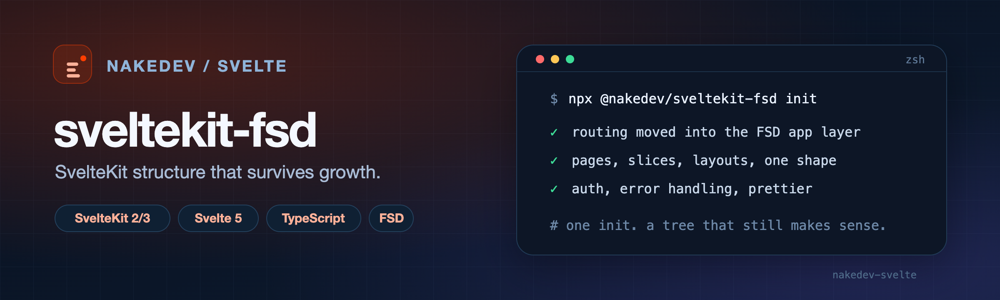
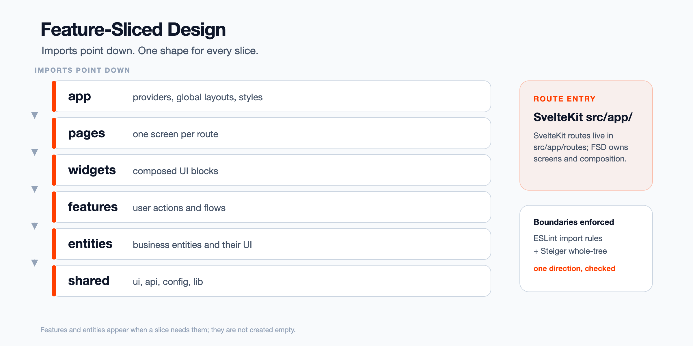

<div align="center">
  
  <h1>sveltekit-fsd</h1>
  <p><strong>SvelteKit structure that survives growth.</strong></p>
  <p>
    <a href="https://www.npmjs.com/package/@nakedev/sveltekit-fsd"></a>
    <a href="https://nodejs.org"></a>
    <a href="https://github.com/NakePranob/sveltekit-fsd/actions/workflows/ci.yml"></a>
    <a href="LICENSE"></a>
  </p>
</div>

`sveltekit-fsd` is an npm CLI for keeping a **SvelteKit** project on
**Feature-Sliced Design**. It moves routing into the FSD app layer once, wires
two linters around the import boundary, and then generates pages, slices, and
layouts with the same shape. Auth, API error handling, and formatting are
commands too.

SvelteKit already creates projects, so this CLI has no `create`. The workflow is
`sv create`, one `sveltekit-fsd init`, then the same CLI from the project
whenever the frontend grows.

## Why sveltekit-fsd

- **Routing is part of the architecture, not beside it.** `init` moves
  `src/routes` into the FSD app layer (`src/app/routes`) instead of leaving two
  structures to drift apart.
- **Every slice has the same shape.** Pages, slices, and layouts are generated
  with the same segments and public APIs.
- **The cross-cutting wiring is already done.** Auth, API error normalization,
  session handling, and formatting arrive as commands, not as a checklist.

## Quick start

```bash
npm install --global @nakedev/sveltekit-fsd
npx sv create my-app --template minimal --types ts --add prettier eslint tailwindcss

cd my-app
sveltekit-fsd init                 # once: move routing, add linters and docs
sveltekit-fsd add auth             # shared/auth + a login page
sveltekit-fsd generate page dashboard --auth
```

Then:

```bash
npm run dev
npm run check                      # svelte-check
npm run lint                       # eslint (import boundary) + steiger (whole tree)
```

`features/` and `entities/` are not created empty; they appear when a slice
actually needs them.

### Requirements

- **Node.js >=20.9** for the CLI.
- A **SvelteKit 2 or 3** project in TypeScript, created by `sv create`.
- **Svelte 5** and runes mode. The generated components use `$props`, `$state`,
  `$derived`, and `$effect`; `sv create` turns runes on for you.
- A SvelteKit 3 app itself needs **Node.js 22.17+**.

## What you get

| Area | What `sveltekit-fsd` gives you |
| --- | --- |
| **App layer** | Routing moved to `src/app/routes`, with layouts, providers, styles, and `app.html` in one FSD app layer. |
| **Layers** | `pages`, `widgets`, `features`, `entities`, and `shared` in the FSD shape. |
| **Boundaries** | ESLint import rules plus Steiger for the whole tree. [See the proof](#proof-it-catches-a-violation). |
| **Generators** | Pages, slices, and layouts with consistent segments and public APIs. |
| **Auth** | A login page, session store, access token handling, route guard, and the API client it needs. |
| **Error handling** | One API error type, error catalogs, and the client boundary that normalises failures. |
| **Formatting** | Prettier with Tailwind class sorting. |
| **Agent guidance** | Repository-level `AGENTS.md`, `CLAUDE.md`, and a generated skill that knows the project's paths. |

## CLI or manual setup?

| Situation | Choose | Why |
| --- | --- | --- |
| One-off project, or the architecture is the experiment | Manual | You keep full control of every file and convention. |
| More than one repository, or the same feature is repeated | CLI | The next project starts with the same shape. |
| More than one person or agent edits the repo | CLI | Boundary checks and agent guidance ship with the scaffold. |
| You need to prove an import is rejected | CLI | ESLint/Steiger or `check` is already wired. |
| Every file must be custom | Manual | The CLI is opinionated by design. |

A manual setup gives you the most freedom. It is the right choice when the architecture is intentionally different, the project is a one-off, or you need to own every file from the first commit. The cost is that every convention — layer boundaries, auth wiring, framework path rules — has to be rebuilt and reviewed again.

The CLI is for repetition. It gives the next project the same shape, encodes framework and layout constraints, and ships boundary checks and agent guidance with the scaffold. It is not automatically faster; a fair cross-project benchmark has not been run.

Use the CLI when repeatability, reviewable boundaries, and a stable target for AI agents matter. Use a manual setup when the architecture itself is the experiment.

## How it fits together



SvelteKit still owns routing, but the route tree lives inside the FSD app layer.
Pages compose widgets, widgets compose features, features use entities, and
everything may use shared. The linters enforce that direction.

## Proof it catches a violation

`shared` is the bottom layer. If it imports `entities` or `pages`, the foundation starts to depend on a screen, becomes harder to test in isolation, and can create circular dependencies. The public `index.ts` rule keeps slices replaceable.

On SvelteKit 2 the alias is `@`; on SvelteKit 3 it is `#`.

```bash
mkdir -p src/shared/lib
cat > src/shared/lib/leak.ts <<'EOF'
import { OrdersPage } from "#/pages/orders";
export const leak = OrdersPage;
EOF

npx eslint .
# exit 1
# no-restricted-imports

npx steiger ./src
# exit 1
# fsd/forbidden-imports
```

`init` writes the `#/*` mapping into both `package.json#imports` and `tsconfig.json#compilerOptions.paths`; the tsconfig half is what lets Steiger resolve the alias on SvelteKit 3.

Remove the probe, or change it to a shared import:

```bash
npm run lint
# exit 0
```

**What this catches:** wrong-direction alias imports and whole-tree FSD structure. **What it does not catch:** dynamic imports, runtime dependency injection, same-layer coupling, and server-side authorization.

## Same input, same output

Measured pilot, not yet a CI gate: three clean copies of the same base, the same CLI version, and the same flags.

- 38 files in each run
- manifest `36d14b9c…`
- A↔B diff: 0
- A↔C diff: 0
- editing one generated file produced an 11-line manifest diff

The manifest is every generated file's relative path plus its SHA-256, excluding `node_modules`, `.git`, `.next`, `.svelte-kit`, and `build`.

## Generated project

```text
src/
├─ app/                      # FSD app layer
│  ├─ routes/                # SvelteKit routes, moved from src/routes
│  ├─ layouts/               # generated layout components
│  ├─ providers/             # query client and other providers
│  ├─ styles/                # app.css
│  └─ index.html             # moved from src/app.html
├─ pages/                    # one folder per route screen
├─ widgets/                  # composed UI blocks
├─ features/                 # user actions
├─ entities/                 # business entities
└─ shared/                   # api, auth, config, ui, lib
```

## Commands

| Command | What it does |
| --- | --- |
| `init` | Move routing into the FSD app layer, add linters and docs. |
| `generate page [name]` | Add a route page with its slice and wiring. |
| `generate slice [layer] [name]` | Add a `features` or `entities` slice. |
| `generate layout [name]` | Add shared chrome for a route group. |
| `add auth` | Add password login, session handling, and a login page. |
| `add error-handling` | Add the API error boundary and error catalogs, with response parsers matching the Go API's contract. |
| `add prettier` | Add formatting with Tailwind class sorting. |
| `config` | Inspect and change project settings. |

Run any command with `--help` for its current options. The full command
reference — wizard behavior, every option, generated output, and limitations —
lives in [`REFERENCE.md`](REFERENCE.md).

## Auth: beta

`add auth` generates the client-side session flow: login page, in-memory access token, refresh handling, session guard, and API error boundary. It is beta: generated projects exercise it, but it has not been audited for production.

**What you still own:** server-side authentication and authorization, CSRF/CORS/cookie policy, token lifetime, and the API contract. The client guard is UX, not authorization.

## What this does not cover

- A production security audit
- Server-side authorization tests
- Dynamic imports and runtime dependency injection
- Every possible FSD coupling; same-layer cross-slice review remains

## Learn more

- [Full command reference](REFERENCE.md)
- [Design notes](docs/design-notes.md)
- [Source, template, and test workflow](AGENTS.md)
- Sibling projects: [`go-scaffold`](https://www.npmjs.com/package/@nakedev/go-scaffold) and [`nextjs-fsd`](https://www.npmjs.com/package/@nakedev/nextjs-fsd)

## Development

```bash
pnpm install --frozen-lockfile
pnpm run build
pnpm run test
```

See [`AGENTS.md`](AGENTS.md) for the source/template/test workflow and the
release contract.

## License

MIT — see [LICENSE](LICENSE).
